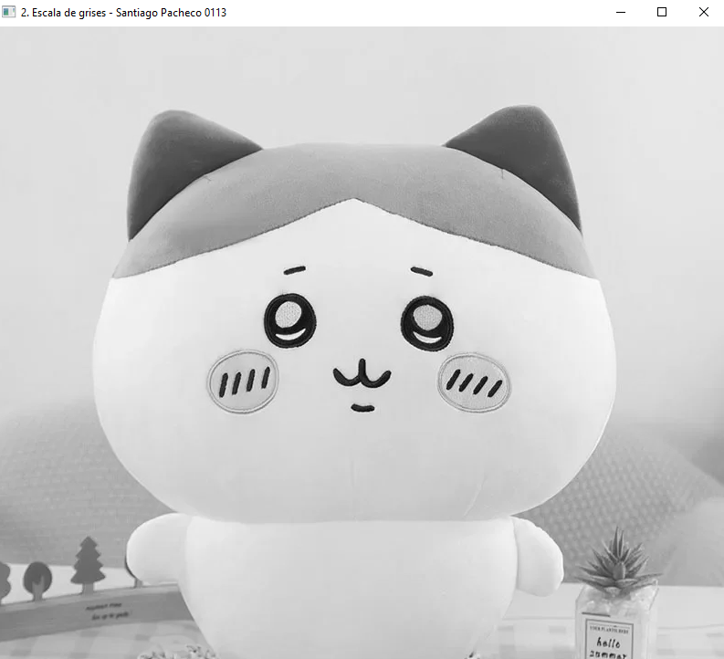
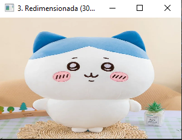
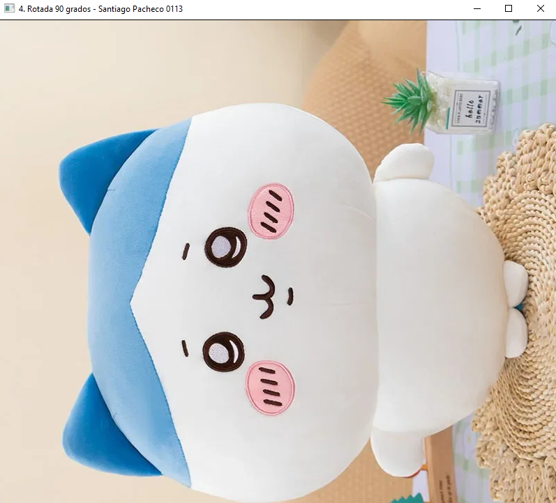
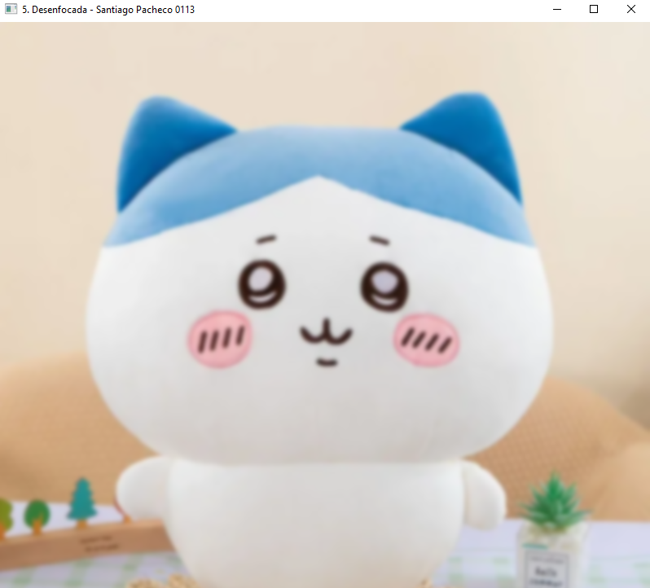
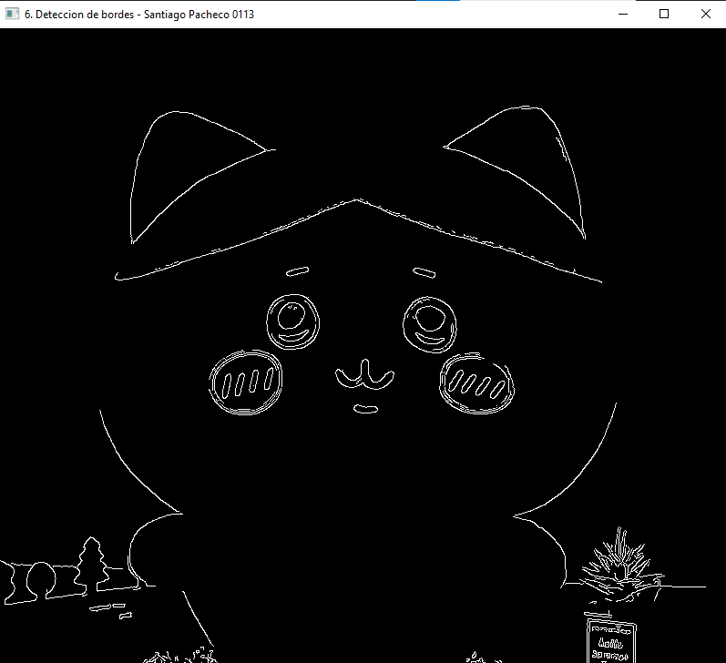
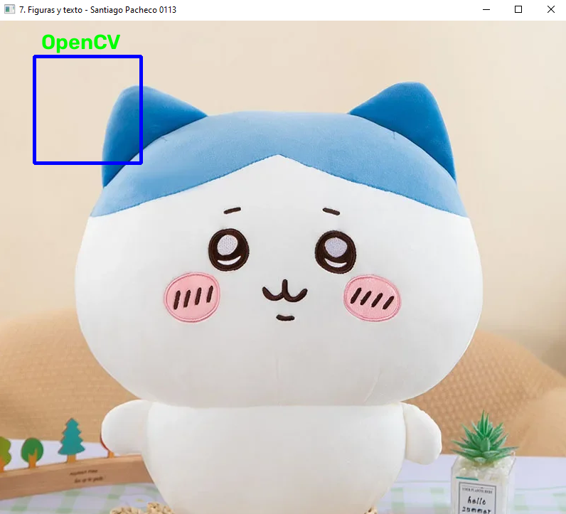
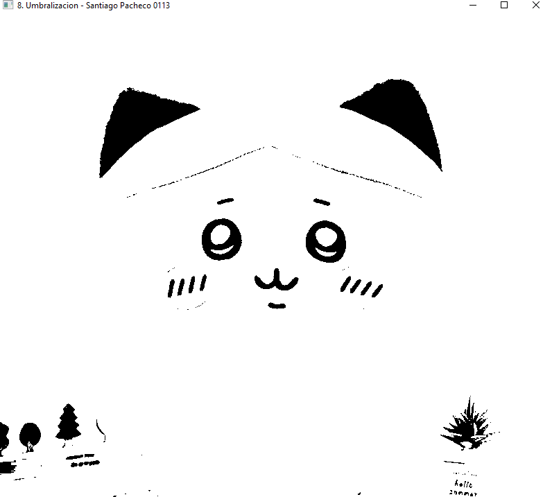
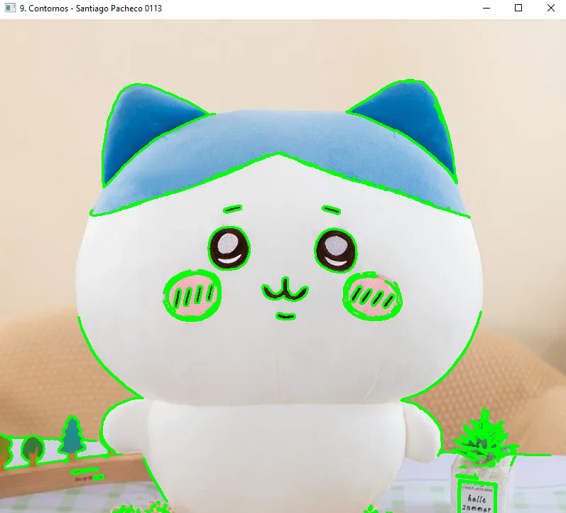

## santiago pacheco 0113

## 1. Mostrar Imagen Original

## 2. Escala de Grises

## 3. Redimensionar

## 4. Rotar Imagen

## 5. Desenfoque (Blur)

## 6. Detección de Bordes

## 7. Dibujar Figuras y Texto

## 8. Umbralización (Blanco y Negro Puro)

## 9. Detectar y Dibujar Contornos
